# ESP32 Environmental Monitoring System

## Project Overview
An ESP32-based environmental monitoring system designed to measure and display real-time environmental conditions. The system uses multiple sensors, an OLED display, and a Wi-Fi dashboard to make environmental data easy to monitor.

## Features
- Real-time temperature, humidity, and atmospheric pressure measurements
- Ambient light monitoring
- OLED display showing live sensor readings
- Wi-Fi dashboard accessible through a web browser
- Live graphs displaying recent sensor data
- Sensor readings recorded every 5 seconds

## Hardware Components
- ESP32-WROOM-32 microcontroller
- BME280 temperature, humidity, and pressure sensor
- BH1750 ambient light sensor
- SSD1306 0.96-inch OLED display
- Custom 3D-printed enclosure
- Perfboard and connecting wires

## Software
The ESP32 collects data from the BME280 and BH1750 sensors using I2C communication. Readings are displayed on the OLED screen and made available through a local web server. The web dashboard displays current measurements and graphs of recent readings.

## Tools and Technologies
- Arduino IDE
- C++
- HTML, CSS, and JavaScript
- Fusion 360
- Bambu Studio

## Future Improvements
- Improve enclosure weather resistance
- Add long-term data storage
- Improve wireless monitoring capabilities

## Project Images

### Hardware and 3D-Printed Enclosure

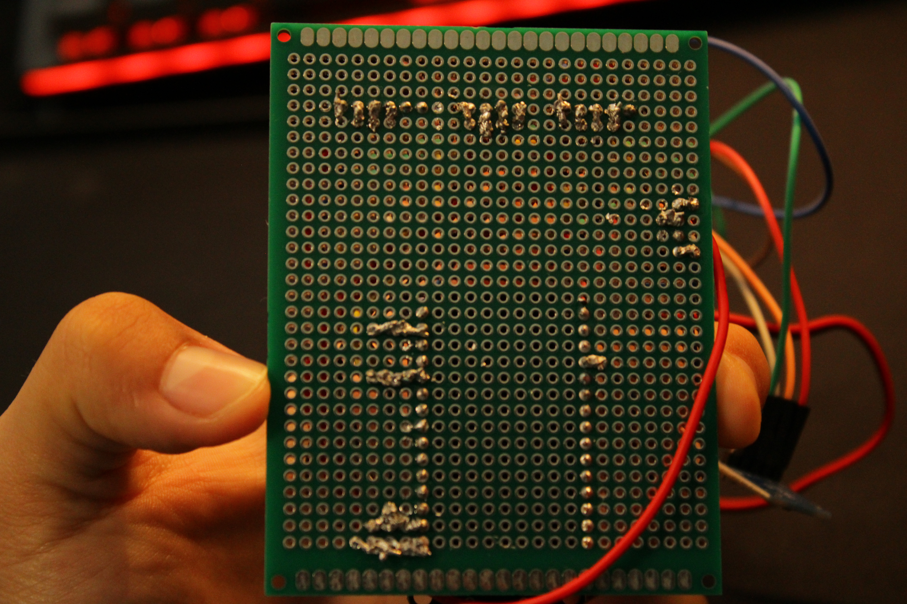

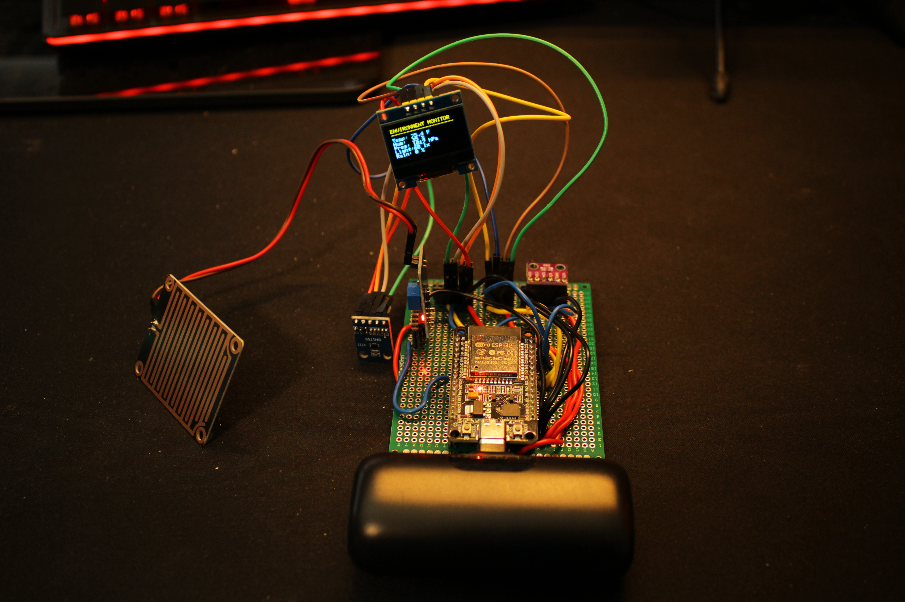

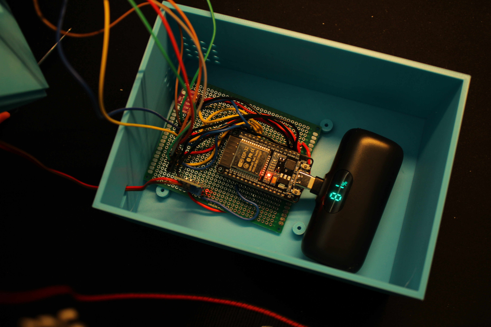

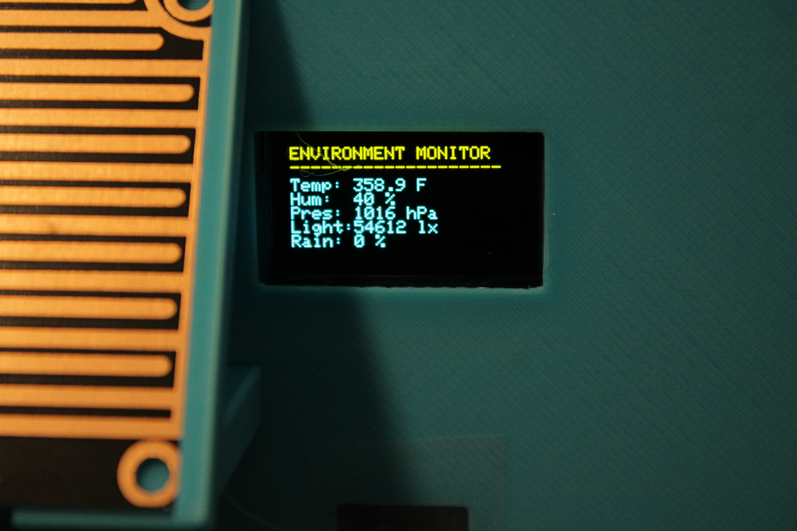

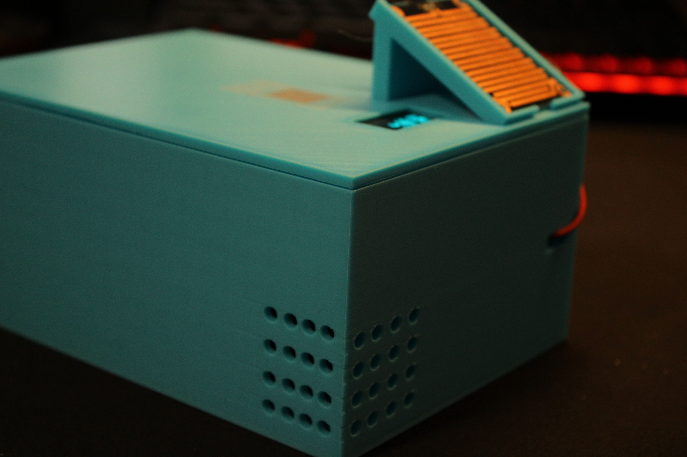

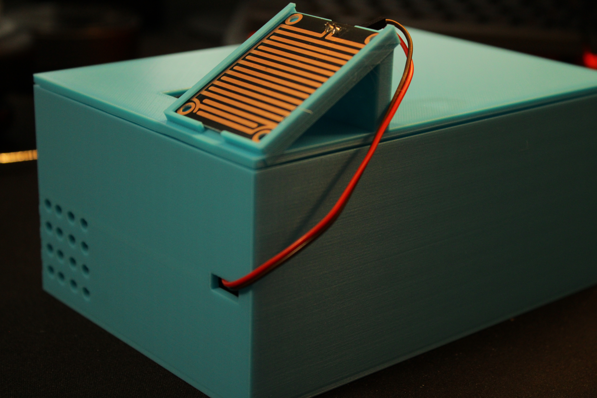

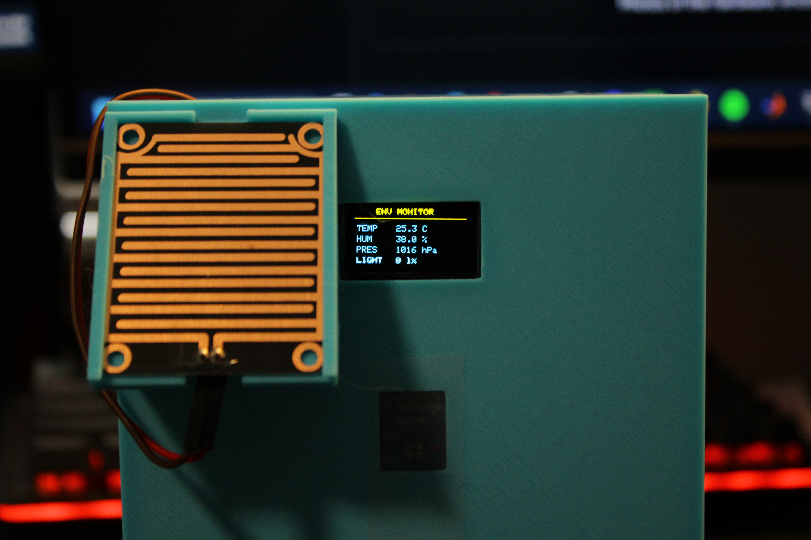

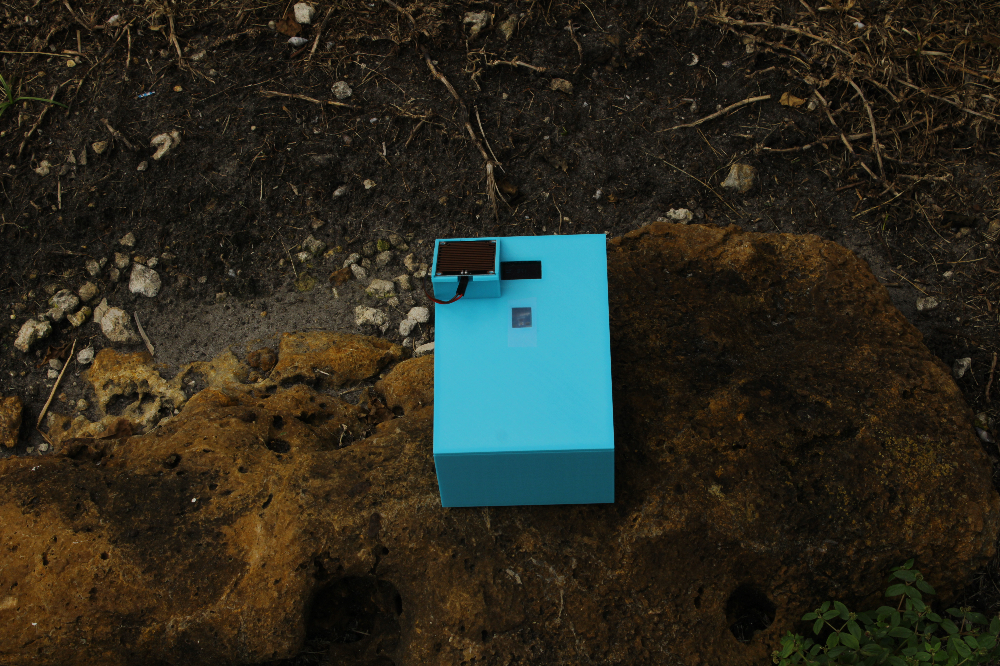

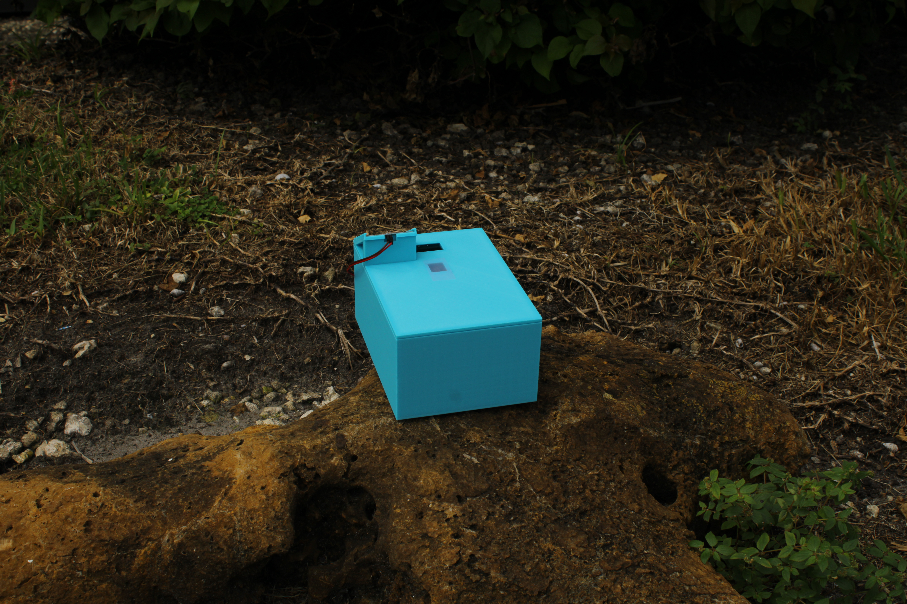

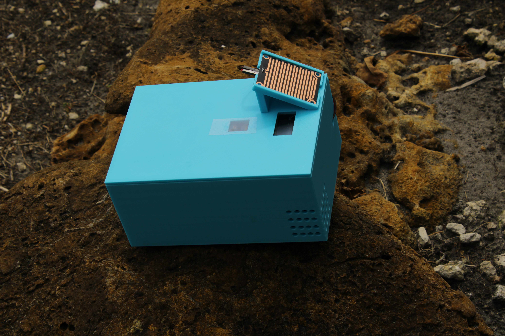

### Web Dashboard and Software

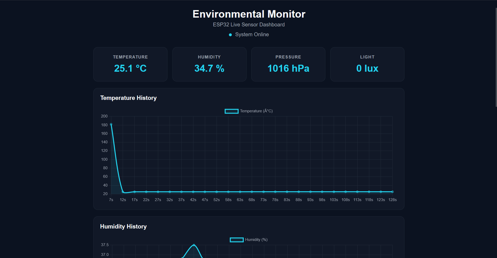

.png)

.png)
